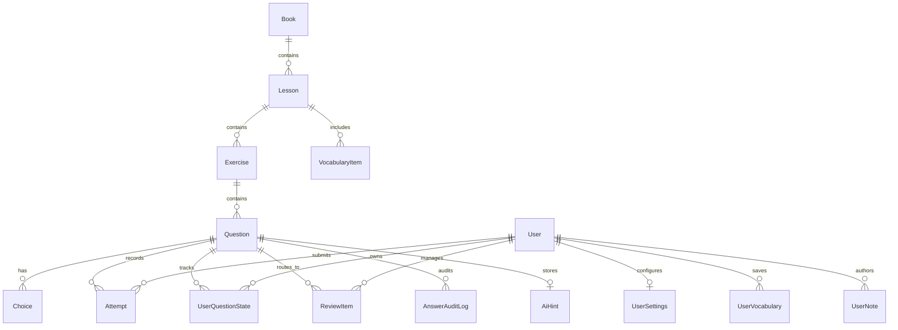

# Deutschly Database Schema

Deutschly uses Prisma ORM targeting **PostgreSQL 16** in production (and SQLite in local development).

---

## 1. Relational Entity Diagram

---

## 2. Table Specifications

### 2.1 Content Hierarchy Tables
* `Book`: Represents an imported textbook (`id`, `title`, `author`, `language`, `sourcePdf`, `totalPages`, `createdAt`).
* `Lesson`: Curriculum units (`id`, `bookId`, `sequenceOrder`, `lessonNumber`, `title`, `pdfStartPage`, `pdfEndPage`, `grammarContent`).
* `Exercise`: Practice sections (`id`, `lessonId`, `exerciseType`, `title`, `instructions`, `passageText`, `pdfPageRef`, `sequenceOrder`).
* `Question`: Individual question (`id`, `exerciseId`, `questionNumber`, `questionText`, `originalHint`, `correctChoiceLabel`, `answerStatus`, `isFlaggedForReview`, `reviewReason`, `pdfPageRef`, `audioFilePath`).
* `Choice`: Answer choices (`id`, `questionId`, `choiceLabel`, `choiceText`, `audioFilePath`).
* `VocabularyItem`: Master dictionary entries (`id`, `lessonId`, `germanWord`, `baseForm`, `article`, `pluralForm`, `meaningAr`, `meaningEn`, `wordType`, `exampleSentence`, `pdfPageRef`).

### 2.2 User Progress & State Tables
* `User`: Student and administrator accounts (`id`, `username`, `email`, `passwordHash`, `role`, `createdAt`).
* `UserSettings`: Preferences (`userId`, `preferredVoice`, `playbackSpeed`, `theme`, `lastBookId`, `lastLessonId`, `updatedAt`).
* `Attempt`: Detailed historical log of each submission (`id`, `userId`, `questionId`, `submittedChoice`, `isCorrect`, `usedHint`, `revealedChoices`, `listenedRevealedChoices`, `attemptTimestamp`).
* `UserQuestionState`: Authoritative state machine for each user/question pair (`userId`, `questionId`, `classification`, `isCompletedSuccessfully`, `attemptsCount`, `lastAttemptAt`).
* `ReviewItem`: Items in Difficult Questions or Wrong Answers (`id`, `userId`, `questionId`, `listType`, `isManuallyRemoved`, `addedAt`, `removedAt`).
* `UserVocabulary`: Words looked up and saved by user (`id`, `userId`, `selectedWord`, `baseWord`, `article`, `pluralForm`, `meaningEn`, `meaningAr`, `wordType`, `status`, `createdAt`).
* `UserNote`: Personal tips and rules (`id`, `userId`, `title`, `content`, `category`, `isFavorite`, `isAiGenerated`, `createdAt`, `updatedAt`).
* `AiHint`: On-demand AI-generated hints (`id`, `questionId`, `hintText`, `createdAt`).
* `AnswerAuditLog`: History of manual answer modifications (`id`, `questionId`, `previousAnswer`, `newAnswer`, `changedBy`, `reason`, `changedAt`).
