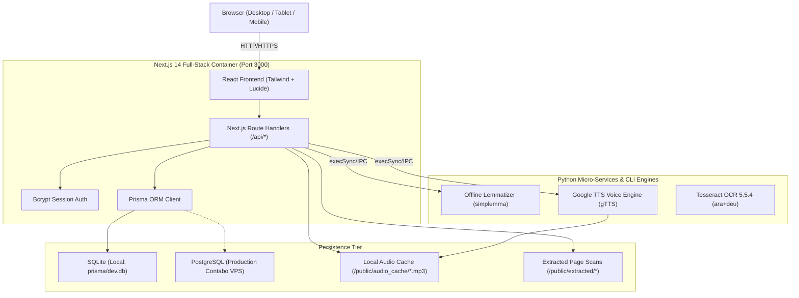
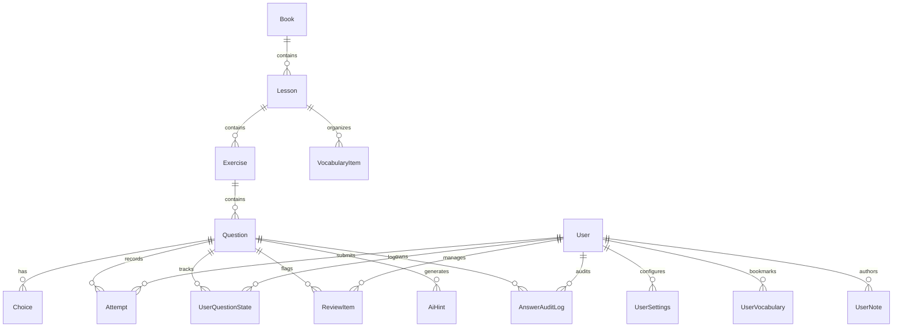

# Technical Documentation: Deutschly Full-Stack Platform

**Author:** Senior Full-Stack Software Architect & Engineering Team  
**Version:** 1.0.0  
**Stack:** Next.js 14 (App Router) · TypeScript · Tailwind CSS · Prisma ORM · SQLite/PostgreSQL · Python 3 · Tesseract OCR · Docker · Nginx  
**Repository:** [https://github.com/hsmoallem/Deutschly](https://github.com/hsmoallem/Deutschly)

---

## 1. System Architecture Overview

Deutschly is built as a modern, decoupled, modular full-stack application. It features a reactive React front-end powered by Next.js 14 App Router, a robust REST API layer, an ORM-backed relational persistence tier, and high-performance Python micro-services for optical character recognition, offline lemmatization, and audio synthesis.



---

## 2. Directory Structure

The project follows a clean, decoupled workspace hierarchy:

```
German learning app/
├── README.md                      # Primary repository entry point
├── code/                          # Production application source code
│   ├── .env                       # Local environment variables (git-ignored)
│   ├── .env.example               # Template environment configuration
│   ├── Dockerfile                 # Multi-stage production container build
│   ├── docker-compose.yml         # Container orchestration (App + Postgres + Nginx)
│   ├── nginx.conf                 # Production reverse proxy & SSL config
│   ├── next.config.mjs            # Next.js configuration
│   ├── package.json               # Dependencies & scripts
│   ├── tsconfig.json              # TypeScript compilation rules
│   ├── tailwind.config.ts         # Tailwind CSS styling framework
│   ├── prisma/
│   │   ├── schema.prisma          # Relational database schema
│   │   └── dev.db                 # Local development SQLite database
│   ├── public/                    # Static assets & media caches
│   │   ├── audio_cache/           # SHA-256 content-addressed MP3 files
│   │   └── extracted/             # High-resolution PDF page crops
│   ├── scripts/
│   │   ├── seed.js                # Database seeder (1,578 questions & choices)
│   │   ├── seed_vocab.py          # Vocabulary seeder (2,306 words & dictionary)
│   │   ├── lookup_word.py         # Offline lemmatizer & lexical query engine
│   │   ├── generate_audio.py      # Server-side TTS synthesis script
│   │   ├── run_tests.js           # 27-point comprehensive QA test suite
│   │   ├── backup_db.sh           # Automated database snapshot script
│   │   └── restore_db.sh          # Database disaster recovery script
│   └── src/
│       ├── app/                   # App Router pages and REST API handlers
│       │   ├── api/               # Serverless route handlers
│       │   ├── admin/             # Verification & page scan inspector
│       │   ├── lessons/           # Curriculum & interactive exercise cards
│       │   ├── difficult/         # Spaced repetition for assisted questions
│       │   ├── wrong/             # Remediation list for failed answers
│       │   ├── dictionary/        # Searchable 2,306-word master lexicon
│       │   ├── vocabulary/        # User bookmarked vocabulary
│       │   ├── notes/             # Student annotations and AI tips
│       │   ├── login/             # Authentication portal
│       │   └── layout.tsx         # Root layout with AudioProvider & Navigation
│       ├── components/            # Reusable UI components
│       ├── context/               # React contexts (AudioContext)
│       └── lib/                   # Utility helpers (Prisma client, Auth utils)
├── documentation/                 # Architectural & functional documentation
│   ├── PRD.md                     # Product Requirements Document
│   ├── TECHNICAL_DOCUMENTATION.md # Comprehensive Technical Architecture (this file)
│   ├── ARCHITECTURE.md            # System architecture overview
│   ├── DATABASE_SCHEMA.md         # Detailed database schema reference
│   ├── CONTENT_INVENTORY.md       # Complete census of 152 pages & questions
│   ├── PDF_EXTRACTION_REPORT.md   # PDF extraction methodology & OCR benchmarks
│   ├── DEPLOYMENT.md              # Contabo VPS & Docker deployment manual
│   ├── ENVIRONMENT_SETUP.md       # Development environment installation steps
│   └── PROJECT_STATUS.md          # Implementation progress tracking
└── antigravity/                   # Agent working tools & extraction artifacts
    ├── output/                    # Verified datasets & sample questions
    └── tools/                     # Python extraction and OCR exploration scripts
```

---

## 3. Relational Database Schema (Prisma ORM)



### Key Models

1. **`Book`**: Represents the curriculum textbook (`totalPages: 152`, `sourcePdf`).
2. **`Lesson`**: Curriculum units (`Lektion 10` to `Lektion 14`, `قاموس الكلمات`, `تدريبات إضافية`).
3. **`Exercise`**: Grouped sets of questions (`exerciseNumber`, `title`, `instructions`, `pdfPageStart`, `pdfPageEnd`).
4. **`Question`**: Individual questions with `questionText`, `questionNumber`, `correctAnswer`, `answerStatus` (`AI_CHECKED`, `USER_PROVIDED`, `VERIFIED`), `isFlagged`, and `pdfPageRef`.
5. **`Choice`**: Options for each question (`choiceLetter`, `choiceText`, `isCorrect`).
6. **`Attempt`**: Granular attempt telemetry (`userAnswer`, `isCorrect`, `usedHint`, `revealedChoices`, `classification`: `SOLVED_INDEPENDENTLY`, `DIFFICULT`, `WRONG`).
7. **`UserQuestionState`**: Denormalized student mastery record per question (`solvedIndependently`, `isDifficult`, `isWrong`, `attemptsCount`).
8. **`ReviewItem`**: Priority queue for spaced repetition (`reviewType`: `DIFFICULT`, `WRONG`).
9. **`VocabularyItem`**: 2,306 textbook vocabulary words with `germanWord`, `baseForm`, `article`, `pluralForm`, `meaningAr`, `wordType`, `exampleSentence`.
10. **`AnswerAuditLog`**: Permanent audit record of changes to answer keys with `previousAnswer`, `newAnswer`, `reason`, `userId`.

---

## 4. REST API Specification

### Authentication
- `POST /api/auth/login`: Authenticates user via username and password, sets HTTP-only session cookie.
- `GET /api/auth/me`: Returns the currently authenticated user session and role.
- `POST /api/auth/logout`: Clears the session cookie.

### Curriculum & Lessons
- `GET /api/lessons`: Retrieves all 7 curriculum units with progress metrics (total questions, solved count, completed status).
- `GET /api/lessons/:id`: Returns detailed lesson hierarchy with exercises, questions, choices, and user attempt state.

### Attempt Execution & Classification
- `POST /api/attempts/submit`:
  - **Request Body:**
    ```json
    {
      "questionId": "cm1...",
      "selectedChoiceId": "cm2...",
      "usedHint": false,
      "revealedChoices": false
    }
    ```
  - **Classification Logic:**
    - If `isCorrect` AND `!usedHint` AND `!revealedChoices` $\to$ `SOLVED_INDEPENDENTLY`.
    - If `isCorrect` AND (`usedHint` OR `revealedChoices`) $\to$ `DIFFICULT`.
    - If `!isCorrect` $\to$ `WRONG`.
  - **Response:**
    ```json
    {
      "attemptId": "cm3...",
      "isCorrect": true,
      "classification": "SOLVED_INDEPENDENTLY",
      "correctAnswer": "A",
      "explanation": null
    }
    ```

### Audio Engine
- `GET /api/audio?text=...`:
  - Computes `hash = sha256(text)`.
  - Checks `public/audio_cache/[hash].mp3`.
  - If missing, invokes `scripts/generate_audio.py` (`gTTS`).
  - Returns audio stream with headers: `Content-Type: audio/mpeg`, `Cache-Control: public, max-age=31536000, immutable`.

### Lexical Intelligence & Lemmatization
- `GET /api/dictionary/lookup?word=...`:
  - Invokes `scripts/lookup_word.py`.
  - Runs `simplemma.lemmatize(word, lang='de')`.
  - Queries `VocabularyItem` table for base form match.
  - Returns grammatical gender, plural marker, part of speech, and textbook Arabic translation.
- `GET /api/dictionary/search?q=...`:
  - Full-text search across 2,306 vocabulary items in German and Arabic.

### Pedagogical AI Hints
- `POST /api/hints/generate`:
  - **Request Body:** `{ "questionId": "..." }`
  - Generates grammatical analysis without revealing the exact choice letter or text.
  - Saves generated hint to `AiHint` table.

### Administrative Verification
- `GET /api/admin/questions`: Lists questions with filtering by flag status, lesson, or search query.
- `PUT /api/admin/questions`:
  - Allows human reviewer to update `correctAnswer` or resolve `isFlagged`.
  - Updates `answerStatus` to `USER_PROVIDED`.
  - Inserts entry into `AnswerAuditLog`.

---

## 5. Optical Character Recognition (OCR) Pipeline

The source PDF (*عبد الرؤوف الكتاب جديد جداااااااا- 2027.pdf*) presents non-standard font stream encodings for Arabic characters on pages 1–138 (Identity-H font encoding).

### Two-Stage Extraction Strategy:
1. **PyMuPDF 300 DPI Rendering:**
   ```python
   pix = page.get_pixmap(dpi=300)
   pix.save(page_image_path)
   ```
2. **Dual-Language Tesseract OCR (5.5.4):**
   ```python
   text = pytesseract.image_to_string(Image.open(page_image_path), lang='ara+deu')
   ```
3. **Bounding Box Alignment & Cropping:**
   - For every question, vertical bounding boxes are calculated.
   - High-resolution PNG crops are saved to `public/extracted/questions/` and `antigravity/output/sample_questions/` for administrative audit inspection.

---

## 6. QA Verification & Test Suite

The automated test runner (`code/scripts/run_tests.js`) validates 27 critical assertions across six subsystems:
1. **Database & Content Integrity:** 7 lessons, 1,578 questions, 6,214 choices, 2,306 vocabulary items.
2. **Offline Lemmatization:** German irregular nouns, plural inflections, and past participles.
3. **Audio Protocol:** SHA-256 caching, file generation, and cache-hit verification.
4. **Classification State Machine:** Scenarios A, B, C, and D for student attempts.
5. **Admin Verification:** Answer updates to `USER_PROVIDED` and audit logging.
6. **Mandatory Documentation:** Verification of PRD, Technical Docs, and schema files.

Run the test suite:
```bash
cd code
node scripts/run_tests.js
```

---

## 7. Contabo VPS Production Deployment

Deutschly includes complete containerization for deployment to a Linux VPS (Ubuntu 22.04 LTS on Contabo):

### Quick Deployment Steps
1. **Clone repository onto VPS:**
   ```bash
   git clone https://github.com/hsmoallem/Deutschly.git /var/www/deutschly
   cd /var/www/deutschly/code
   ```
2. **Configure Environment:**
   ```bash
   cp .env.example .env
   # Set DATABASE_URL, NEXTAUTH_SECRET, and ADMIN_PASSWORD
   ```
3. **Launch with Docker Compose:**
   ```bash
   docker-compose up -d --build
   ```
4. **Seed Database:**
   ```bash
   docker-compose exec app npx prisma db push
   docker-compose exec app node scripts/seed.js
   docker-compose exec app python3 scripts/seed_vocab.py
   ```
5. **SSL Certificate (Let's Encrypt):**
   ```bash
   certbot --nginx -d yourdomain.com
   ```
